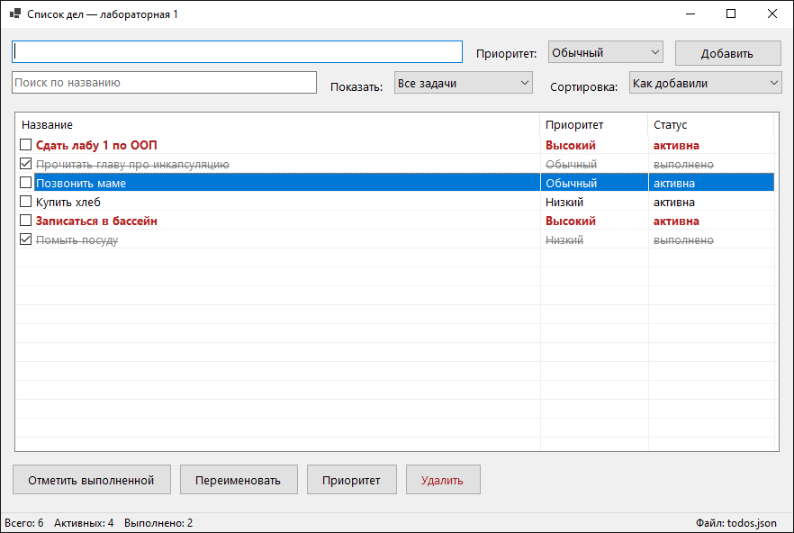
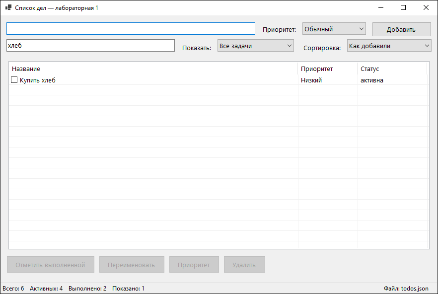

# Лабораторная 1. Список дел

| | |
| --- | --- |
| Автор | Соловьев Матвей Станиславович |
| Язык, интерфейс | C# 12, .NET 8, WinForms |
| Доп. поле задачи | приоритет: низкий / обычный / высокий |
| Доп. задания | ★ и ★★ сделаны |

Оконное приложение для списка задач: задачи заводятся, отмечаются выполненными,
переименовываются, удаляются и сохраняются в JSON, чтобы пережить перезапуск.



## Что умеет

- добавить задачу с названием и приоритетом (пустое название не принимается);
- отметить задачу выполненной и вернуть в работу — флажком в списке или кнопкой;
- переименовать задачу — кнопкой, двойным кликом по строке или клавишей `F2`;
- сменить приоритет через кнопку «Приоритет»;
- удалить задачу — кнопкой или клавишей `Delete`, с подтверждением;
- фильтр «все / только активные / только выполненные» и сортировка по названию,
  приоритету или статусу;
- поиск по названию: список фильтруется по мере ввода;
- задачи с высоким приоритетом выделены красным и жирным, выполненные — серые
  и зачёркнутые;
- всё сохраняется в JSON и загружается при запуске.

## Как запустить

Нужен .NET SDK 8.0 (`dotnet --version` должен показать 8.x).

Из папки `lab1-todo`:

```bash
dotnet run --project src/TodoApp
```

Или собрать решение и запустить готовый файл:

```bash
dotnet build TodoApp.sln
./src/TodoApp/bin/Debug/net8.0-windows/TodoApp.exe
```

Файл с задачами: `%APPDATA%\OopTodo\todos.json`. Если файла нет — программа
стартует с пустым списком. Чтобы начать с чистого листа, файл можно удалить.
Имя файла видно в строке состояния, полный путь — во всплывающей подсказке.
Если папка в профиле недоступна для записи (бывает на чужих или защищённых
машинах), программа сохраняет задачи рядом с исполняемым файлом.

## Чек-лист

| # | Требование | Где сделано | Готово |
| --- | --- | --- | --- |
| 1 | Модель: классы задачи и списка, поля закрыты, изменение только методами, в модели нет окна и вывода | `src/TodoApp.Core/TodoItem.cs`, `TodoList.cs` — все поля `private`, сеттеров нет, проект не ссылается на WinForms | ✔ |
| 2 | Окно: поле ввода, кнопка «Добавить», список с отметкой выполнения и дополнительным полем | `src/TodoApp/MainForm.cs`: `TextBox`, `Button`, `ListView` с флажками и колонками «Название», «Приоритет», «Статус» | ✔ |
| 3 | Операции «выполнить», «переименовать», «удалить», список обновляется сразу | `MainForm.ToggleSelected_Click`, `RenameSelected`, `DeleteSelected`; после каждого действия вызывается `RefreshView()` | ✔ |
| 4 | Ошибки: пустое название, действие без выбранной задачи, неверное значение доп. поля — сообщение, программа продолжает работать | `TodoItem.Rename`/`SetPriority` бросают `ArgumentException`/`ArgumentOutOfRangeException`, окно ловит их в `try/catch` и показывает `MessageBox`; `RequireSelection` — про «выберите задачу» | ✔ |
| 5 | Сохранение в JSON и загрузка при запуске, нет файла — пустой список | `TodoList.Save` / `TodoList.Load` (`System.Text.Json`), вызовы из `MainForm.SaveToDisk`/`LoadFromDisk` | ✔ |
| 6 | README: как запустить, скриншот, чек-лист, устройство проекта | этот файл | ✔ |

## Дополнительные задания

**★ Фильтр и сортировка (3 балла).** Фильтр «все / активные / выполненные» —
метод `TodoList.Filter`, сортировка по названию, приоритету, статусу — метод
`TodoList.Sort`; вместе они собираются в `TodoList.BuildView`, который окно
вызывает при каждом изменении. Всё это методы модели, окно только передаёт
выбранные значения.

**★★ Поиск и выделение цветом (3 балла).** Поиск — метод `TodoList.Find`
(без учёта регистра, по части названия), список фильтруется по мере ввода в
поле поиска. Задачи с высоким приоритетом выделены красным и жирным, а
выполненные — серым и зачёркнутым.



## Как устроен проект

```
lab1-todo/
├── TodoApp.sln
├── src/
│   ├── TodoApp.Core/          модель, без библиотеки окна
│   │   ├── TodoItem.cs        одна задача: название, признак выполнения, приоритет
│   │   ├── TodoList.cs        список задач: добавить, удалить, изменить,
│   │   │                      найти, отфильтровать, отсортировать, сохранить, загрузить
│   │   ├── Priority.cs        перечисление приоритетов и их подписи
│   │   └── TodoStorage.cs     путь к файлу задач
│   └── TodoApp/               окно
│       ├── Program.cs         точка входа
│       ├── MainForm.cs        главное окно
│       └── TextPromptDialog.cs  маленькое окно «введите новое название»
└── tests/
    └── CoreChecks/            проверки модели без интерфейса
```

**Классы и наследование.** `MainForm` и `TextPromptDialog` наследуются от
`System.Windows.Forms.Form` — это окна. `TodoItem` и `TodoList` объявлены
`sealed`: наследовать их не нужно, они связаны композицией — `TodoList` хранит
`List<TodoItem>`, а окно держит одну `TodoList` и показывает её. Ни `TodoItem`,
ни `TodoList` не знают про окно: проект `TodoApp.Core` не ссылается на WinForms,
поэтому модель можно проверить отдельной консольной программой.

**Модель и окно.** Окно не хранит задачи и не меняет их поля напрямую: оно
вызывает методы `TodoList` (`Add`, `Rename`, `Complete`, `Remove`, `SetPriority`)
и после каждого действия перерисовывает список по модели (`RefreshView`).
Ошибки модель сообщает исключениями, окно ловит их и показывает `MessageBox` —
поэтому правила живут в одном месте и работают, даже если окно потом поменяется.

**Что использовали.** WinForms (окно, `ListView` с флажками, `StatusStrip`,
`ContextMenuStrip`), `System.Text.Json` с `JsonStringEnumConverter` (задачи
пишутся в JSON, приоритет — строкой, чтобы файл читался глазами), LINQ для
фильтра и сортировки, исключения для проверки данных, `System.IO` для файла.
Для JSON модель превращается в маленькие записи `TodoItemData` — так поля
`TodoItem` остаются закрытыми.

## Проверки модели

Модель проверяется консольной программой без окна и без NuGet:

```bash
dotnet run --project tests/CoreChecks
```

Проверяются: запрет пустого названия, обрезка пробелов, `Complete`/`Reopen`,
переименование, удаление чужой задачи, фильтры, сортировки, поиск, сохранение и
загрузка JSON, отсутствие файла и повреждённый файл. Программа печатает
`OK`/`FAIL` по каждому пункту и возвращает код 1, если что-то не прошло.

## Ответы на вопросы (для защиты)

1. **Класс и объект.** Класс — описание данных и действий (`TodoItem`), объект —
   конкретная задача со своими значениями. Класс один, объектов сколько угодно.
2. **Конструктор** вызывается при создании объекта и приводит его в корректное
   состояние: `TodoItem(string title, Priority priority)` проверяет название и
   приоритет, поэтому после `new` объект уже правильный.
3. **Поля закрыты**, чтобы объект нельзя было испортить в обход проверок: пустое
   название или неизвестный приоритет не пройдут, а значение меняется только
   методом, который проверяет данные.
4. **`this`** — объект, у которого вызван метод. Метод один на класс, а `this`
   указывает, чьи поля менять: `second.Complete()` меняет только `second`.
5. **Модель бросает исключение, а не показывает окно**, потому что не знает, где
   её используют: в окне, в консоли или в проверках. Исключение описывает
   ошибку, а как её показать, решает тот, кто вызвал метод.
6. **Обработчик события** — метод, который окно вызывает в ответ на действие
   пользователя (нажатие кнопки, изменение текста). Он берёт ввод, вызывает
   метод модели и обновляет окно.
7. **Задачи хранятся в модели** (`TodoList`), а не в окне: окно только показывает
   то, что вернула модель, и не может «потерять» задачу при перерисовке.
8. **В файл и обратно**: `Save` превращает задачи в записи `TodoItemData` и
   сериализует их в JSON; `Load` читает JSON, создаёт по каждой записи
   `TodoItem` и заменяет содержимое списка. Нет файла — список пустой.
