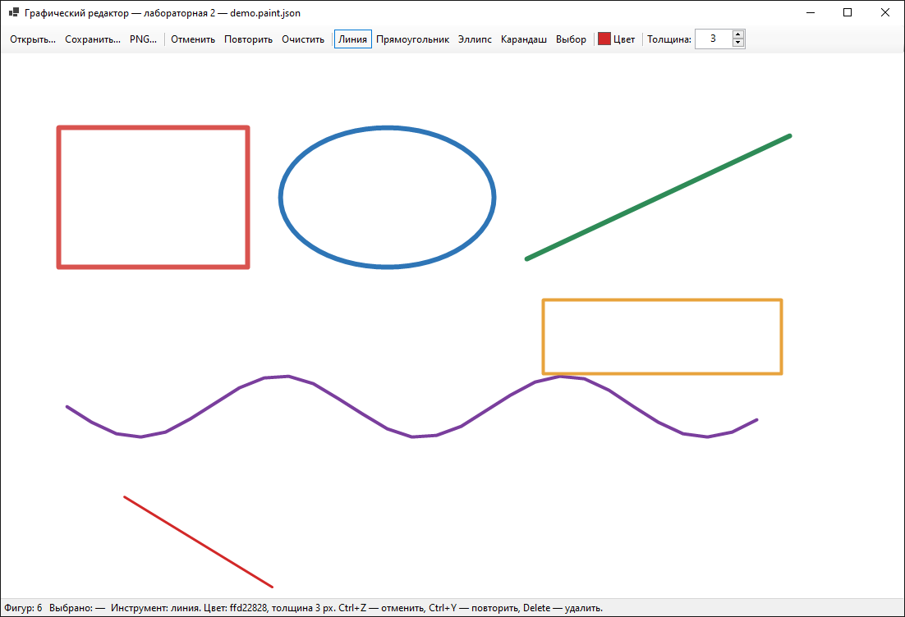
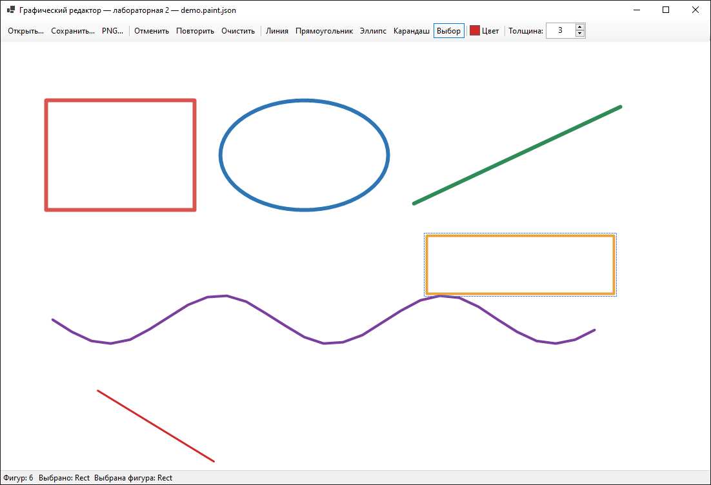

# Лабораторная 2. Графический редактор

| | |
| --- | --- |
| Автор | Соловьев Матвей Станиславович |
| Язык, интерфейс | C# 12, .NET 8, WinForms |
| Ветка, папка | `lab2`, `lab2-paint/` |
| Доп. задания | ★ и ★★ сделаны |

Оконный редактор: мышью рисуются линии, прямоугольники, эллипсы и кривые
карандашом; рисунок сохраняется в JSON и открывается обратно, выгружается в PNG.



Картинка со скриншота лежит рядом: `docs/demo.paint.json` — откройте её через
«Открыть…» или запустите `PaintApp.exe docs\demo.paint.json`.

## Что умеет

- инструменты: линия, прямоугольник, эллипс, карандаш, выбор — выбранный
  инструмент подсвечен в панели и подписан в строке состояния;
- фигура рисуется протягиванием мыши и видна во время протягивания
  (предпросмотр), тянуть можно в любую сторону;
- цвет выбирается диалогом, толщина — от 1 до 32 px;
- отмена последнего действия (Ctrl+Z) и повтор (Ctrl+Y);
- «Очистить» убирает все фигуры — тоже отменяется через Ctrl+Z;
- сохранение рисунка в JSON и открытие с восстановлением типов, цветов,
  толщин и всех точек карандаша;
- выгрузка рисунка в PNG;
- ★ выделение фигуры щелчком, перетаскивание мышью, удаление клавишей Delete;
- ★★ отмена и повтор через объекты-команды, экспорт в PNG.

## Как запустить

Нужен .NET SDK 8.0 (`dotnet --version` должен показать 8.x).

Из папки `lab2-paint`:

```bash
dotnet run --project src/PaintApp
```

Или собрать решение и запустить готовый файл:

```bash
dotnet build PaintApp.sln
./src/PaintApp/bin/Debug/net8.0-windows/PaintApp.exe
```

Можно сразу открыть готовый рисунок:

```bash
dotnet run --project src/PaintApp -- docs/demo.paint.json
```

## Горячие клавиши

| Клавиши | Действие |
| --- | --- |
| `1` … `5` | линия, прямоугольник, эллипс, карандаш, выбор |
| `Ctrl+Z` / `Ctrl+Y` | отменить / повторить |
| `Ctrl+S` / `Ctrl+O` | сохранить / открыть |
| `Delete` | удалить выбранную фигуру |
| `Esc` | снять выделение и бросить недорисованную фигуру |

## Чек-лист

| # | Требование | Где сделано | Готово |
| --- | --- | --- | --- |
| 1 | Окно: холст, выбор инструмента, цвета и толщины; выбранный инструмент виден | `MainForm.BuildToolStrip`, `SetTool`: кнопки инструментов подсвечиваются, строка состояния пишет текущий инструмент, цвет и толщину | ✔ |
| 2 | Линия, прямоугольник, эллипс рисуются протягиванием с предпросмотром в любом направлении; карандаш рисует кривую | `MainForm.Canvas_MouseDown/Move/Up` создают фигуру, `Shape.MoveEnd` тянет вторую точку, `CanvasControl.Preview` рисует её поверх холста; `RectShape.Bounds` берёт минимум координат и модуль разницы | ✔ |
| 3 | Абстрактный `Shape`, у каждой фигуры свой `Draw`; рисунок рисуется одним циклом без проверки типа | `Shape.Draw` абстрактный, `Drawing.Draw` — `foreach (var shape in _shapes) shape.Draw(graphics);` | ✔ |
| 4 | Отмена последней фигуры (Ctrl+Z) и очистка — методы `Drawing` | `Drawing.RemoveAt/Remove/Clear`, `ClearDrawingCommand`; Ctrl+Z в `MainForm.ProcessCmdKey` | ✔ |
| 5 | Сохранение в JSON и открытие с восстановлением фигур, цветов и толщин | `Drawing.Save/Load`: в файле `Type`, `Color`, `Width`, точки; при загрузке `CreateShape` создаёт нужный класс по `Type` | ✔ |
| 6 | README: как запустить, скриншот, чек-лист, устройство проекта | этот файл | ✔ |

## Дополнительные задания

**★ Выделение, перемещение, удаление (3 балла).** У `Shape` есть абстрактный
`Contains(Point)` — каждая фигура решает сама: прямоугольник проверяет, что
точка внутри, эллипс — уравнение эллипса, линия и карандаш — расстояние до
отрезка. Инструмент «Выбор» находит верхнюю фигуру под курсором
(`Drawing.HitTest`), рисует вокруг неё пунктирную рамку, перетаскивает мышью и
удаляет по `Delete`.



**★★ Отмена и повтор через команды, экспорт в PNG (3 балла).** Каждое действие —
объект с `Execute()` и `Undo()`: `AddShapeCommand`, `DeleteShapeCommand`,
`ClearDrawingCommand`, `MoveShapeCommand`. Их складывает в две стопки
`CommandHistory`, поэтому Ctrl+Z и Ctrl+Y работают и после удаления, и после
очистки холста. Экспорт — `Drawing.ExportPng`: рисунок рисуется в `Bitmap` и
сохраняется в PNG.

## Как устроен проект

```
lab2-paint/
├── PaintApp.sln
├── src/
│   ├── PaintApp.Core/          модель: фигуры, рисунок, команды
│   │   ├── Shape.cs            абстрактный базовый класс: точки, цвет, толщина
│   │   ├── LineShape.cs        отрезок
│   │   ├── RectShape.cs        прямоугольник
│   │   ├── EllipseShape.cs     эллипс
│   │   ├── PencilShape.cs      кривая: список точек
│   │   ├── Drawing.cs          список фигур, JSON, PNG, попадание мышью
│   │   └── Commands.cs         ICommand и стопки отмены/повтора
│   └── PaintApp/               окно
│       ├── Program.cs          точка входа
│       ├── MainForm.cs         панель инструментов, мышь, файлы
│       └── CanvasControl.cs    холст: рисует список фигур и предпросмотр
├── tests/
│   └── CoreChecks/             87 проверок модели без окна
└── docs/                       скриншоты и пример рисунка
```

**Наследование.** `Shape` — абстрактный базовый класс: в нём общее (две точки,
цвет, толщина, `Bounds`, `MoveEnd`, `Translate`, служебные методы расстояний), а
`Draw` и `Contains` объявлены без реализации. `LineShape`, `RectShape`,
`EllipseShape`, `PencilShape` наследуются от него и переопределяют `Draw` (а
`PencilShape` ещё и `MoveEnd`, `Bounds`, `Translate`). Окна наследуются от
`Form` (`MainForm`) и `Control` (`CanvasControl`).

**Композиция.** `Drawing` содержит `List<Shape>` — это поле, а не наследование.
`MainForm` содержит `Drawing` и `CommandHistory`. Холст не хранит фигуры: он
получает `Drawing` и только рисует его.

**Полиморфизм.** `Drawing.Draw` вызывает `shape.Draw(graphics)` для каждой
фигуры, не проверяя тип: вызывается метод того класса, которым объект является
на самом деле. Чтобы добавить треугольник, нужен новый класс `TriangleShape :
Shape` с двумя методами — цикл рисования и файл не меняются (в `CreateShape`
добавится одна строка).

**Формат файла.** JSON с версией и массивом фигур:

```json
{
  "Version": 1,
  "Shapes": [
    { "Type": "Rect", "Color": "#FFD9534F", "Width": 6, "X1": 70, "Y1": 90, "X2": 300, "Y2": 260 },
    { "Type": "Pencil", "Color": "#FF7A3E9D", "Width": 4, "X1": 80, "Y1": 430, "X2": 940, "Y2": 400,
      "Points": [ { "X": 80, "Y": 430 }, { "X": 110, "Y": 455 } ] }
  ]
}
```

Цвет — `#AARRGGBB`, поэтому сохраняется и прозрачность. При загрузке `Drawing`
проверяет версию, тип фигуры, толщину и цвет: неизвестный тип или испорченный
JSON не роняют программу — окно показывает сообщение.

## Проверки модели

```bash
dotnet run --project tests/CoreChecks
```

87 проверок: границы фигур при протягивании в любую сторону, `Contains` для
линии, прямоугольника, эллипса и карандаша, сдвиг фигур, работа `Drawing`
(добавить, вставить, удалить, найти под точкой, очистить), команды и стопки
отмены/повтора, сохранение и загрузка всех четырёх типов фигур, испорченные
файлы (битый JSON, неизвестный тип, нулевая толщина, непонятный цвет),
рисование на картинке и экспорт PNG.

## Ответы на вопросы (для защиты)

1. **Наследование** — механизм, при котором класс-наследник получает поля и
   методы базового класса и добавляет свои. Отношение «является»:
   прямоугольник является фигурой, поэтому наследуется от `Shape`.
2. **Конструктор базового класса** вызывают, чтобы общая часть (точки, цвет,
   толщина) инициализировалась в одном месте: `RectShape(...) : base(start,
   color, width)`. Без этого базовый объект остался бы недонастроенным.
3. **Абстрактный класс** — класс, объект которого нельзя создать; он описывает
   общее и требует от наследников реализовать абстрактные методы. `Shape`
   абстрактный, потому что «просто фигуру» нарисовать нельзя.
4. **Полиморфизм** — один и тот же вызов ведёт себя по-разному в зависимости от
   настоящего типа объекта. У нас `Drawing.Draw` вызывает `shape.Draw(...)`, и
   для линии рисуется линия, для эллипса — эллипс, без проверок типа.
5. **Чтобы появился треугольник**, нужно добавить класс `TriangleShape : Shape`
   с `Draw` (три линии) и `Contains` (точка внутри треугольника), добавить
   `"Triangle"` в `CreateShape` и кнопку инструмента в окне. Цикл рисования и
   сохранение уже готовы.
6. **Переопределение метода** — замена реализации виртуального/абстрактного
   метода базового класса своей (`override`). `RectShape.Draw` переопределяет
   `Shape.Draw`.
7. **Список хранит `Shape`**, потому что рисование и сохранение работают с общим
   поведением, а не с конкретными классами. Если хранить разные списки, цикл
   рисования придётся писать для каждого типа, а новый тип потребует правок во
   всех местах.
