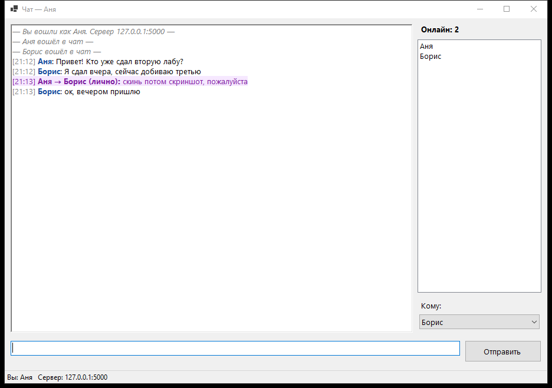
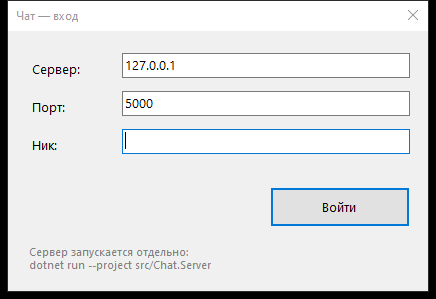

# Лабораторная 3. Онлайн-чат

| | |
| --- | --- |
| Автор | Соловьев Матвей Станиславович |
| Состав | 2 человека (см. «Кто что делал») |
| Язык, интерфейс | C# 12, .NET 8, WinForms-клиент, консольный сервер |
| Ветка, папка | `lab3`, `lab3-chat/` |
| Доп. задания | ★ и ★★ сделаны |

Сервер и оконный клиент группового чата: вход по нику, лента с ником и временем,
список участников онлайн, личные сообщения и история, которая переживает
перезапуск сервера.





## Кто что делал

| Участник | Что делал |
| --- | --- |
| Соловьев Матвей | протокол `ChatMessage`, сервер и обработчик клиента, история в файле, тесты, окна `LoginForm`/`ChatForm` |
| второй участник пары | вписать: что делал напарник (и добавить его в Settings → Collaborators) |

## Как запустить

Нужен .NET SDK 8.0.

**1. Сервер** (можно на любом компьютере в сети):

```bash
cd lab3-chat
dotnet run --project src/Chat.Server -- --port 5000
```

Порт по умолчанию 5000, файл истории — `history.jsonl` рядом с exe.
Свой путь: `--history D:\chat\history.jsonl`. Остановка — `Ctrl+C`.

**2. Клиент**:

```bash
dotnet run --project src/Chat.WinForms
```

В окне входа: адрес сервера, порт, ник. Чтобы подключались с других
компьютеров, сервер слушает `IPAddress.Any`; в клиенте укажите IP сервера, а в
брандмауэре Windows разрешите входящие для `Chat.Server.exe` (или для порта 5000).

Проверки без окон:

```bash
dotnet run --project tests/ChatChecks
```

## Чек-лист

| # | Требование | Где сделано | Готово |
| --- | --- | --- | --- |
| 1 | Сервер и клиент — отдельные программы; адрес и порт вводятся в окне входа; работает по сети | `src/Chat.Server` (консоль) и `src/Chat.WinForms` (окно); поля адреса и порта в `LoginForm`; сервер слушает `IPAddress.Any` | ✔ |
| 2 | Вход с ником, отказ при занятом нике, уведомления о входе и выходе | `ClientHandler.TryLogin` + `ChatServer.TryRegister` (ник под `lock`, повторный отклоняется); `BroadcastNotice` при входе и выходе | ✔ |
| 3 | Лента с ником и временем, отправка кнопкой и Enter, сообщение получают все, список онлайн актуален | `ChatForm.AppendChat`, `SendCurrent`; Enter в поле ввода; `ChatServer.Broadcast`; список приходит сообщением `users` после каждого входа/выхода и по запросу `who` | ✔ |
| 4 | Классы из таблицы; сетевой клиент не знает про окно; протокол описан в README | `ChatMessage`, `ChatServer`, `ClientHandler`, `ChatClient` (события `MessageReceived`/`Disconnected`), `LoginForm`, `ChatForm`; протокол — раздел ниже | ✔ |
| 5 | Окно не замирает, отключение клиента не ломает сервер, недоступный сервер — сообщение | вход выполняется через `Task.Run`, чтение сети — в фоновом потоке, обновление окна через `BeginInvoke`; `finally` в `ClientHandler.Run` убирает клиента; ошибка подключения показывается в `LoginForm` | ✔ |
| 6 | README: запуск, скриншот, чек-лист, устройство, протокол, кто что делал | этот файл | ✔ |

## Дополнительные задания

**★ Личные сообщения (3 балла).** В панели справа есть список онлайн и выбор
«Кому:». Выбранный ник уходит в поле `target`, сервер отправляет сообщение только
адресату и отправителю (`ClientHandler.HandleText` → `ChatServer.SendTo`), в ленте
оно выделено цветом и пометкой «(лично)». В историю личные сообщения не пишутся.

**★★ История (3 балла).** `MessageStore` дописывает каждое общее сообщение в
`history.jsonl` и держит последние сообщения в памяти. Новому клиенту сразу после
`login-ok` уходят последние 20 сообщений с признаком `history: true` — они
показываются серым. После перезапуска сервер читает файл, поэтому история не
теряется.

## Как устроен проект

```
lab3-chat/
├── ChatApp.sln
├── src/
│   ├── Chat.Common/        протокол: ChatMessage, типы сообщений, правила ника
│   ├── Chat.Server/        ChatServer, ClientHandler, MessageStore, консольный Program
│   ├── Chat.Client/        ChatClient: подключение, отправка, чтение в фоне
│   └── Chat.WinForms/      LoginForm, ChatForm, Program
├── tests/
│   └── ChatChecks/         61 проверка: протокол, ник, история и живой TCP-обмен
└── docs/                   скриншоты
```

**Потоки.** Сервер: главный поток принимает подключения, на каждого клиента —
свой `Thread` с `ClientHandler.Run`. Клиент: вход выполняется синхронно (с
таймаутом 5 с), дальше чтение сети идёт в фоновом потоке `chat-read`, а окно
получает сообщения через событие и `BeginInvoke`.

**Блокировка.** Список клиентов меняют потоки всех подключений, поэтому
`ChatServer` держит его под `lock` и наружу отдаёт копию: рассылка идёт по
снимку списка, чтобы не держать блокировку во время отправки в сокет.

**Кто о чём знает.** `ChatClient` не знает про WinForms: он поднимает события
`MessageReceived` и `Disconnected`. Окно подписывается на них; сообщения,
пришедшие до подписки (история сразу после входа), клиент придерживает и отдаёт
при подписке, чтобы ничего не потерялось.

## Протокол

Одно сообщение — одна строка JSON (UTF-8, разделитель `\n`). TCP не сохраняет
границы сообщений, поэтому обе стороны читают построчно.

| `type` | Куда | Поля | Смысл |
| --- | --- | --- | --- |
| `login` | клиент → сервер | `nick` | представиться |
| `login-ok` | сервер → клиент | `nick`, `text` | ник принят |
| `login-error` | сервер → клиент | `text` | отказ: ник занят, пустой ник и т. п. |
| `text` | оба | `nick`, `text`, `time`, `target?` | сообщение; `target` — личное |
| `notice` | сервер → клиент | `text`, `time` | вход, выход, остановка сервера |
| `users` | сервер → клиент | `users` (массив ников) | кто сейчас онлайн |
| `who` | клиент → сервер | — | «пришли список участников» |

Примеры:

```json
{"type":"login","nick":"Аня","text":"","time":"2026-11-27T21:12:50+10:00"}
{"type":"login-ok","nick":"Аня","text":"Добро пожаловать в чат!","time":"2026-11-27T21:12:50+10:00"}
{"type":"text","nick":"Аня","text":"привет всем","time":"2026-11-27T21:12:57+10:00"}
{"type":"text","nick":"Аня","text":"только тебе","target":"Борис","time":"2026-11-27T21:13:01+10:00"}
{"type":"users","text":"","time":"2026-11-27T21:12:58+10:00","users":["Аня","Борис"]}
```

## Проверки

```bash
dotnet run --project tests/ChatChecks
```

61 проверка: JSON-протокол (включая кириллицу и битые строки), правила ника,
история в памяти и файле, и главное — настоящий обмен по TCP: два и три клиента,
рассылка, личные сообщения (третий клиент их не видит), отказ при занятом нике,
уведомления о входе и выходе, работа сервера после отключения клиента, история
после перезапуска сервера и сообщение об ошибке для недоступного сервера.

## Ответы на вопросы (для защиты)

1. **Сервер и клиент.** Сервер ждёт подключений на порту и обслуживает всех;
   клиент сам подключается к серверу по адресу и порту и общается только с ним.
2. **Порт** — число, которое отличает одну программу на компьютере от другой:
   по паре «IP-адрес + порт» ОС находит нужный сокет.
3. **Сообщения разделяют**, потому что TCP — поток байтов: два сообщения могут
   прийти склеенными, а одно — частями. Мы шлём по строке на сообщение и читаем
   построчно, поэтому границы восстанавливаются.
4. **Поток на каждого клиента** нужен, потому что чтение из сокета блокирующее:
   пока один клиент молчит, сервер должен обслуживать остальных и принимать новые
   подключения.
5. **Окно замирает**, если читать сеть в его потоке: поток окна занят ожиданием
   данных и не обрабатывает сообщения Windows — окно не перерисовывается и не
   реагирует на мышь.
6. **Блокировка** нужна потому, что список клиентов меняют несколько потоков
   одновременно (вход, выход, рассылка); без `lock` словарь может испортиться.
7. **Сетевой клиент не знает про окно**, чтобы его можно было использовать и в
   консоли, и в тестах, и менять интерфейс, не трогая сеть. Он сообщает о
   событиях, а как их показать, решает окно.
8. **Какую часть писал ты** — см. таблицу «Кто что делал» в начале README.
